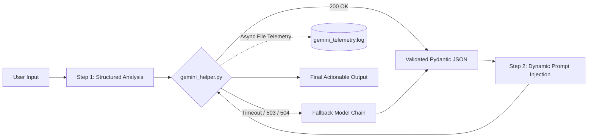

# Gemini Agentic Workflows & Resilient Prompt Chaining

A production-oriented Python toolkit demonstrating **multi-step prompt chaining**, **automatic model fallback**, **Pydantic structured JSON outputs**, and **file-based telemetry logging** using the official `google-genai` SDK.

## Architecture Overview

Every LLM call passes through a resilient wrapper (`gemini_helper.py`) that enforces a strict 15-second timeout, automatically fails over across model tiers on `503`/`504` errors, validates structured JSON schemas via Pydantic, and routes token/latency metrics to `gemini_telemetry.log` to keep CLI execution clean.



## Key Features
* **Resilient Model Fallback (`ask_gemini`):** Automatically fails over across `gemini-3.8-flash` $\rightarrow$ `gemini-3.5-flash` $\rightarrow$ `gemini-3.5-flash-lite` $\rightarrow$ `gemini-3.1-flash-lite` with configurable timeouts.
* **Type-Safe Structured Outputs:** Uses `pydantic.BaseModel` schemas (`response_schema`) so Step 1 outputs guaranteed JSON fields that feed deterministically into Step 2 prompts.
* **Clean Console + File Telemetry:** Captures HTTP status codes, model latency (`ms`), and input/output token counts in `gemini_telemetry.log` without cluttering stdout.
* **Practical Multi-Step Workflows (`two_step_workflows.py`):**
  1. **Statistical Mean $\rightarrow$ Number Trivia:** Computes dataset statistics, extracts a structured `DatasetAnalysis` object, and generates domain facts about the rounded mean.
  2. **Aurora MySQL Query Optimizer:** Diagnoses slow SQL queries into a structured `QueryDiagnosis` schema (bottleneck, target table, composite index columns) and generates zero-downtime `ALGORITHM=INPLACE, LOCK=NONE` DDL plus rollback commands.

## Quickstart

### 1. Clone & Set Up Environment
```bash
git clone https://github.com<YOUR_USERNAME>/gemini-agentic-workflows.git
cd gemini-agentic-workflows

python3 -m venv .venv
source .venv/bin/activate
pip install -r requirements.txt
```

### 2. Configure API Key
```bash
cp .env.example .env
# Add your GEMINI_API_KEY inside .env
```

### 3. Run the Workflows & Monitor Telemetry
```bash
# Run interactive 2-step workflows
python two_step_workflows.py

# Optional: tail telemetry logs in a split terminal pane
tail -f gemini_telemetry.log
```

