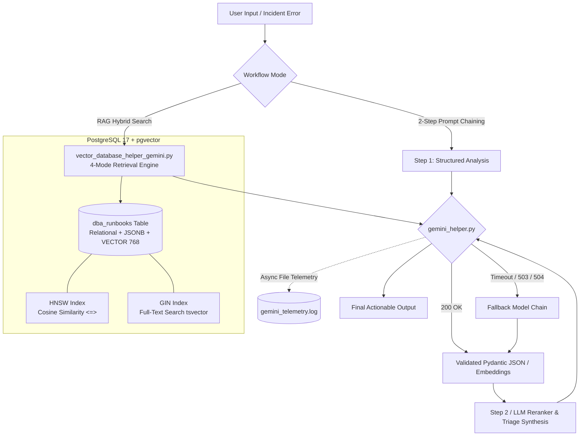

# Gemini Agentic Workflows & Hybrid `pgvector` Retrieval Engine

A production-oriented Python toolkit demonstrating **multi-step prompt chaining**, **PostgreSQL 17 (`pgvector`) hybrid vector + keyword retrieval**, **automatic model fallback**, **Pydantic structured JSON outputs**, and **file-based telemetry logging** using the official `google-genai` SDK.

## Architecture Overview

Every LLM and embedding call passes through a resilient wrapper (`gemini_helper.py`) that enforces a strict 15-second timeout, automatically fails over across model tiers on errors or timeouts, validates structured JSON schemas via Pydantic, and routes token/latency metrics to `gemini_telemetry.log` to keep CLI execution clean.



## Key Features
* **Resilient Model & Embedding Fallback (`gemini_helper.py`):** Automatically fails over across text models (`gemini-3.8-flash` → `gemini-3.5-flash` → `gemini-3.5-flash-lite` → `gemini-3.1-flash-lite`) and embedding models (`gemini-embedding-001` → `text-embedding-004`) with configurable 15-second timeouts.
* **Zero-ETL Hybrid Search in PostgreSQL (`vector_database_helper_gemini.py`):** Combines dense semantic cosine similarity (`<=>`) via **HNSW** indexes with sparse full-text keyword ranking (`ts_rank_cd`) via **GIN** indexes inside a single ACID-compliant PostgreSQL 17 instance.
* **4-Mode Unified Retrieval Engine:** Supports `"dense"`, `"sparse"`, `"hybrid"` (weighted `alpha` blending), and `"hybrid_rerank"` (two-stage retrieval with Pydantic-enforced LLM reranking), plus `'simple'` Unicode tokenization for cross-lingual queries (including Assamese, Hindi, and Spanish).
* **Type-Safe Structured Outputs:** Uses `pydantic.BaseModel` schemas (`response_schema`) so intermediate steps output guaranteed JSON fields that feed deterministically into downstream prompts.
* **Clean Console + File Telemetry:** Captures HTTP status codes, model latency (`ms`), embedding dimensions, and input/output token counts in `gemini_telemetry.log` without cluttering stdout.
* **Practical Workflows Included:**
  1. **Interactive DBA Error-to-Solution Assistant (`vector_demo.py`):** Vectorizes historical Aurora MySQL, PostgreSQL, and IAM runbooks into `pgvector`, retrieves the closest matches via hybrid search + LLM reranking, and generates a 3-bullet on-call triage plan.
  2. **Statistical Mean → Number Trivia (`two_step_workflows.py`):** Computes dataset statistics, extracts a structured `DatasetAnalysis` object, and generates domain facts about the rounded mean.
  3. **Aurora MySQL Query Optimizer (`two_step_workflows.py`):** Diagnoses slow SQL queries into a structured `QueryDiagnosis` schema (bottleneck, target table, composite index columns) and generates zero-downtime `ALGORITHM=INPLACE, LOCK=NONE` DDL plus rollback commands.

## Repository Structure

```text
gemini-agentic-workflows/
├── docker-compose.yml                 # Spins up PostgreSQL 17 with pgvector locally
├── gemini_helper.py                   # Resilient Gemini LLM & embedding client with fallback
├── vector_database_helper_gemini.py   # pgvector table setup (HNSW + GIN), CRUD & 4-mode search
├── vector_demo.py                     # Interactive DBA error-to-solution triage assistant
├── two_step_workflows.py              # Multi-step prompt chaining with Pydantic schemas
├── requirements.txt                   # Pinned Python dependencies
├── .env.example                       # Sanitized environment variable template
└── .gitignore                         # Blocks .env, .venv, and runtime telemetry logs
```

## Quickstart

### 1. Clone & Set Up Environment
```bash
git clone https://github.com<YOUR_USERNAME>/gemini-agentic-workflows.git
cd gemini-agentic-workflows

python3 -m venv .venv
source .venv/bin/activate
pip install -r requirements.txt
```

### 2. Configure API Key & PostgreSQL Credentials
```bash
cp .env.example .env
# Add your GEMINI_API_KEY and chosen POSTGRES_PASSWORD inside .env
```

### 3. Run the Workflows & Monitor Telemetry
```bash
# Option A: Start local PostgreSQL 17 + pgvector and run the interactive DBA runbook demo
docker compose up -d
python vector_demo.py

# Option B: Run the interactive 2-step prompt chaining workflows
python two_step_workflows.py

# Optional: tail telemetry logs in a split terminal pane
tail -f gemini_telemetry.log
```

## Deploying to AWS Aurora PostgreSQL

To switch `vector_demo.py` from local Docker to **Amazon Aurora PostgreSQL**:
1. Provision an Aurora PostgreSQL cluster (`16+` or `17+`) with inbound TCP port `5432` allowed from your client IP.
2. Update `DB_HOST`, `POSTGRES_USER`, `POSTGRES_PASSWORD`, and set `DB_SSLMODE=require` in your `.env` file.
3. Run `python vector_demo.py`—`init_vector_table()` automatically enables `CREATE EXTENSION IF NOT EXISTS vector;` and builds the HNSW and GIN indexes on Aurora.

